# Tugas Praktikum 9 DPBO 2526 C2 (TP9DPBO2526C2)
Aplikasi **Sistem Rekrutmen** berbasis **PHP Native** dengan arsitektur **Model-View-Presenter (MVP)** pola **Strict Passive View** dan basis data MySQL melalui PDO (*Prepared Statements*) untuk pengelolaan data **Kandidat** dan **Lowongan Kerja**.

---

## Janji

> Saya Muhammad Zidan Mirza Fedrieka dengan NIM 2507692 mengerjakan Tugas Praktikum 9 dalam mata kuliah Desain Pemrograman Berorientasi Objek untuk keberkahan-Nya maka saya tidak melakukan kecurangan seperti yang telah dispesifikasikan. Aamiin.

---

## 1. Desain Program & Arsitektur MVP (*Strict Passive View*)

### A. Pemisahan Tanggung Jawab (*Model-View-Presenter*)
1. **Model (`project/models/`)**:
   - Mengelola koneksi database (`DB.php`) dan seluruh kueri SQL dengan *Prepared Statements* PDO.
   - Menggunakan kontrak antarmuka `KontrakModel` dan `KontrakModelLowongan`.
   - Terdiri atas entity (`Kandidat`, `Lowongan`) dan pengelola tabel (`TabelKandidat`, `TabelLowongan`).
2. **View (`project/views/` & `project/template/`)**:
   - Menerapkan prinsip **Strict Passive View**: View hanya membaca template HTML (`skin.html`, `form.html`, `lowongan_skin.html`, `lowongan_form.html`) dan mengganti *placeholder token* (`{{...}}`).
   - View tidak mengakses Model/Entity secara langsung, tidak memiliki `foreach`, dan tidak melakukan perhitungan `count()`.
   - Menggunakan kontrak `KontrakView` dan `KontrakViewLowongan`.
3. **Presenter (`project/presenters/`)**:
   - Menjadi pusat komunikasi antara Model dan View melalui kontrak `KontrakPresenter` dan `KontrakPresenterLowongan`.
   - Mengambil data dari Model, menghitung total data, merakit baris HTML tabel (`<tr>...</tr>`), dan meneruskannya ke View.

### B. Skema Database (`mvp_kandidat_db`)

1. **Tabel `kandidat`**
   - `id` (`INT`, `AUTO_INCREMENT`, `PRIMARY KEY`)
   - `nama` (`VARCHAR(100)`)
   - `posisi` (`VARCHAR(100)`)
   - `domisili` (`VARCHAR(100)`)
   - `skorTes` (`INT`)
   - `pengalamanTahun` (`INT`)

2. **Tabel `lowongan`**
   - `id` (`INT`, `AUTO_INCREMENT`, `PRIMARY KEY`)
   - `judul` (`VARCHAR(100)`)
   - `departemen` (`VARCHAR(100)`)
   - `lokasi` (`VARCHAR(100)`)
   - `kuota` (`INT`)
   - `status` (`VARCHAR(30)`)

---

## 2. Alur Program

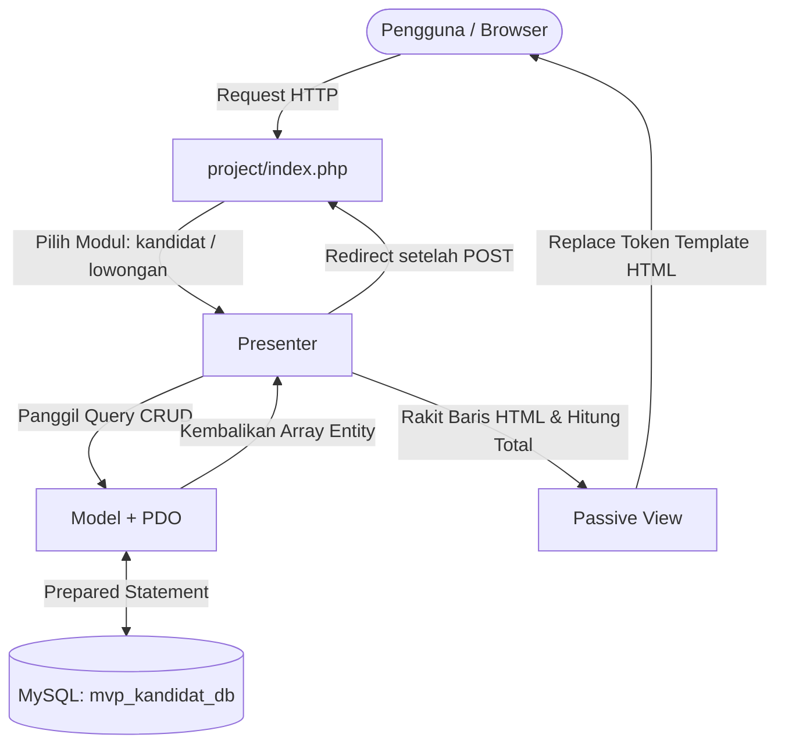

1. **Tampil Data (`screen=list`)**: `index.php` mengarahkan request ke `tampilkanKandidat()` atau `tampilkanLowongan()`. Presenter mengambil seluruh data dari Model, menyusun baris tabel HTML, lalu View mengganti token `{{TABLE_ROWS}}` dan `{{TOTAL_DATA}}` pada template.
2. **Tambah Data (`screen=add` & `action=tambah`)**: Presenter meminta View merender form kosong. Saat form dikirim via `POST`, `index.php` memanggil `tambahKandidat()` atau `tambahLowongan()` pada Presenter untuk menyimpan data melalui Model lalu mengarahkan kembali ke halaman daftar.
3. **Ubah Data (`screen=edit&id=...` & `action=ubah`)**: Presenter mengambil satu data berdasarkan ID melalui Model untuk mengisi nilai awal form. Saat form dikirim via `POST`, Presenter memperbarui data melalui Model lalu mengarahkan kembali ke halaman daftar.
4. **Hapus Data (`action=hapus`)**: Tombol hapus mengirim `POST` berisi `id` ke `index.php`, lalu Presenter memanggil `hapusKandidat()` atau `hapusLowongan()` pada Model dan mengarahkan kembali ke halaman daftar.

---

## 3. Panduan Menjalankan Program

### Prasyarat
- **PHP**: Versi 8.0 atau lebih baru (dengan ekstensi `pdo_mysql`).
- **Database**: MySQL / MariaDB (port default `3306`).

### Langkah Menjalankan
1. Nyalakan layanan MySQL, lalu impor berkas `mvp_db.sql`:
   ```bash
   mysql -u root < mvp_db.sql
   ```
2. Jalankan server PHP dari dalam direktori `project/`:
   ```bash
   cd project
   php -S localhost:8000
   ```
3. Buka browser dan akses `http://localhost:8000`.

---

## 4. Dokumentasi Program Saat Dijalankan

### A. Modul Kandidat (`kandidat`)
1. **Daftar Kandidat Awal**
   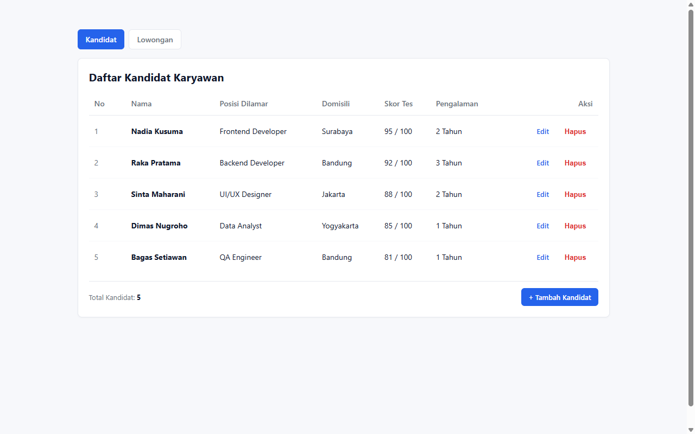
2. **Form Tambah Kandidat**
   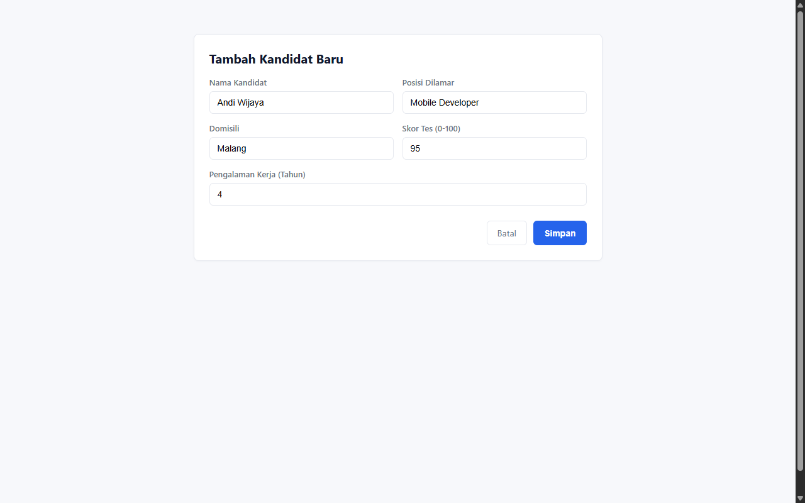
3. **Hasil Tambah Kandidat**
   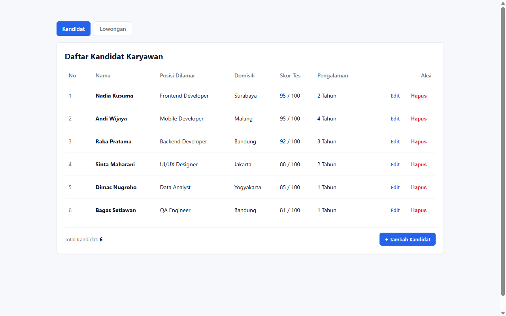
4. **Form Ubah Data Kandidat**
   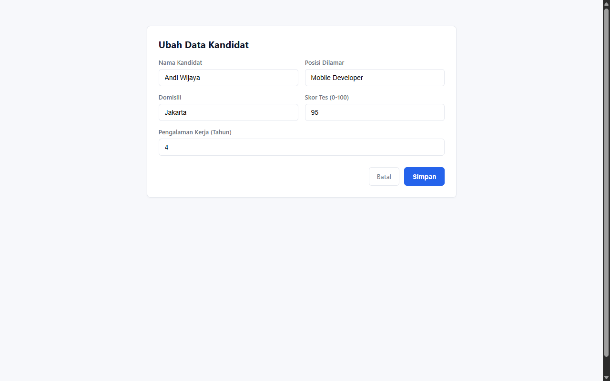
5. **Hasil Ubah Data Kandidat**
   
6. **Konfirmasi Hapus Data Kandidat**
   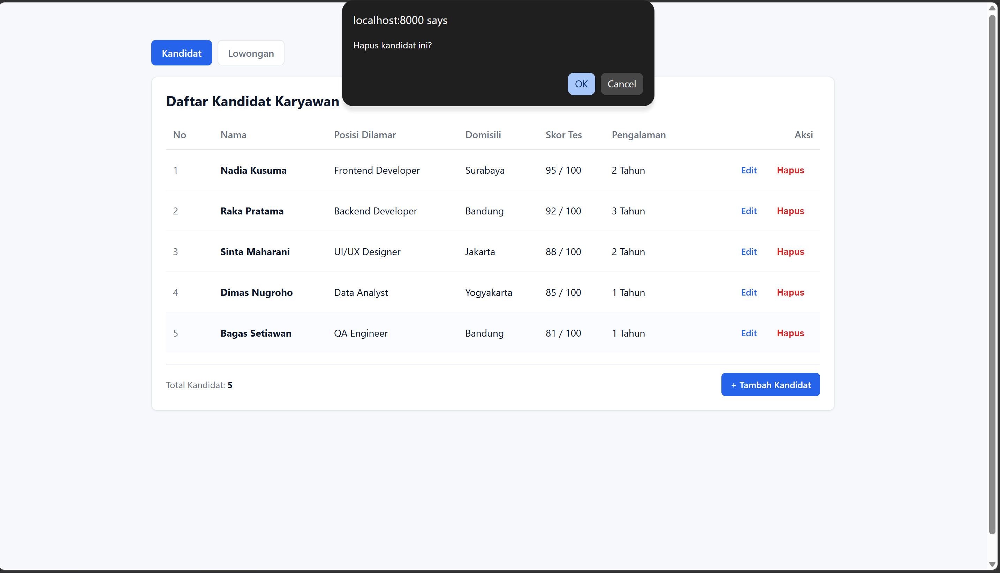
7. **Hasil Hapus Data Kandidat**
   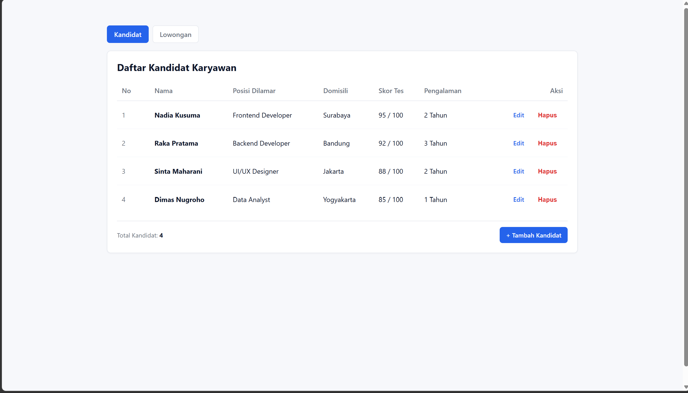

### B. Modul Lowongan (`lowongan`)
1. **Daftar Lowongan Awal**
   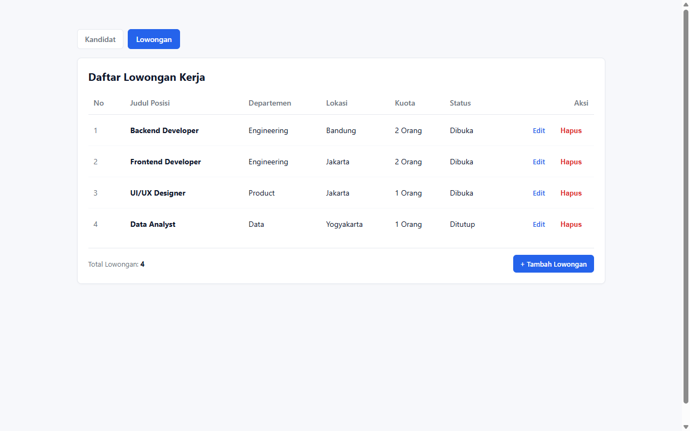
2. **Form Tambah Lowongan**
   
3. **Hasil Tambah Lowongan**
   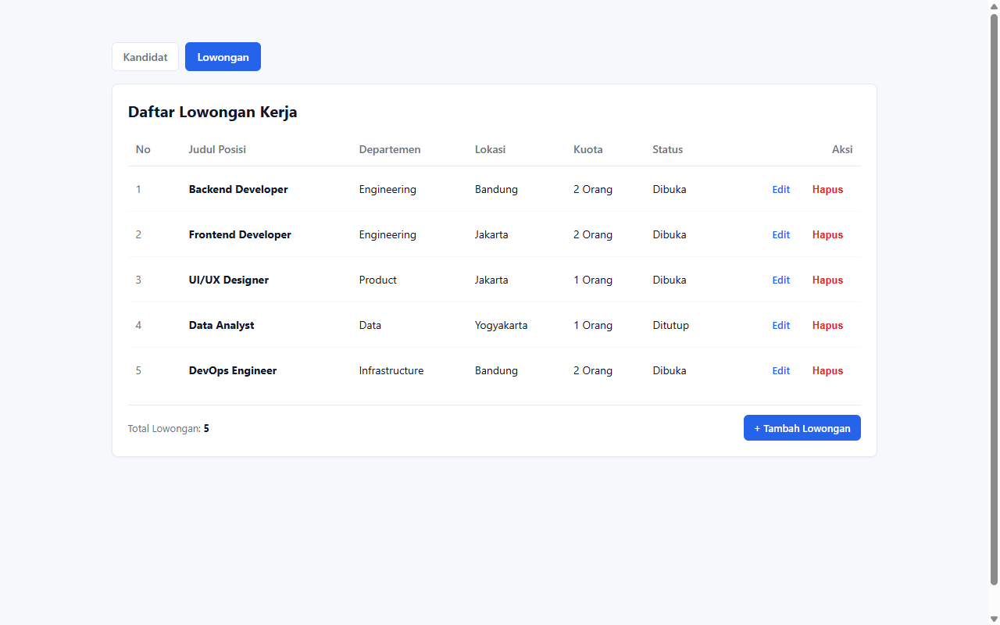
4. **Form Ubah Data Lowongan**
   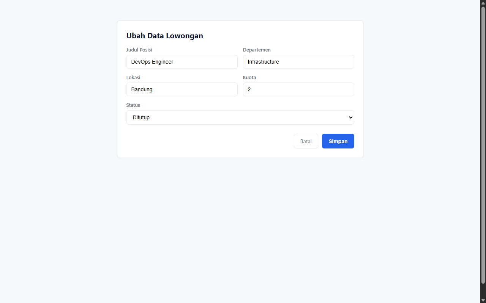
5. **Hasil Ubah Data Lowongan**
   
6. **Konfirmasi Hapus Data Lowongan**
   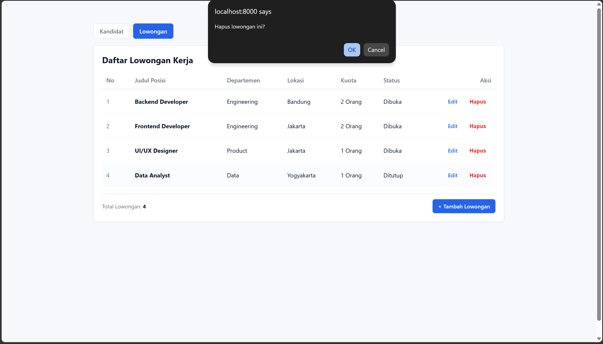
7. **Hasil Hapus Data Lowongan**
   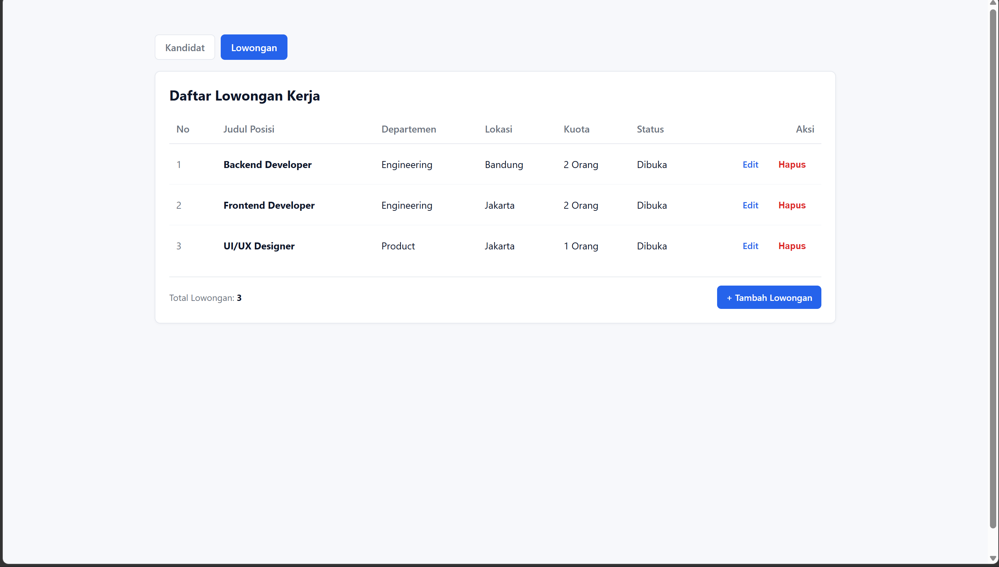
